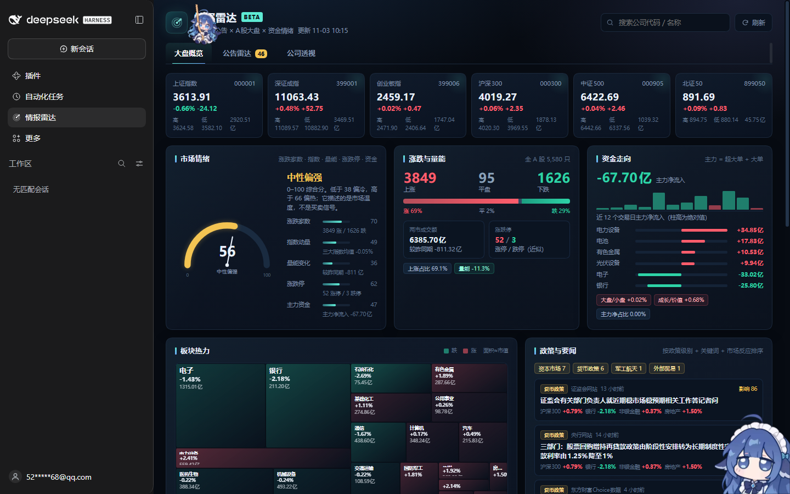
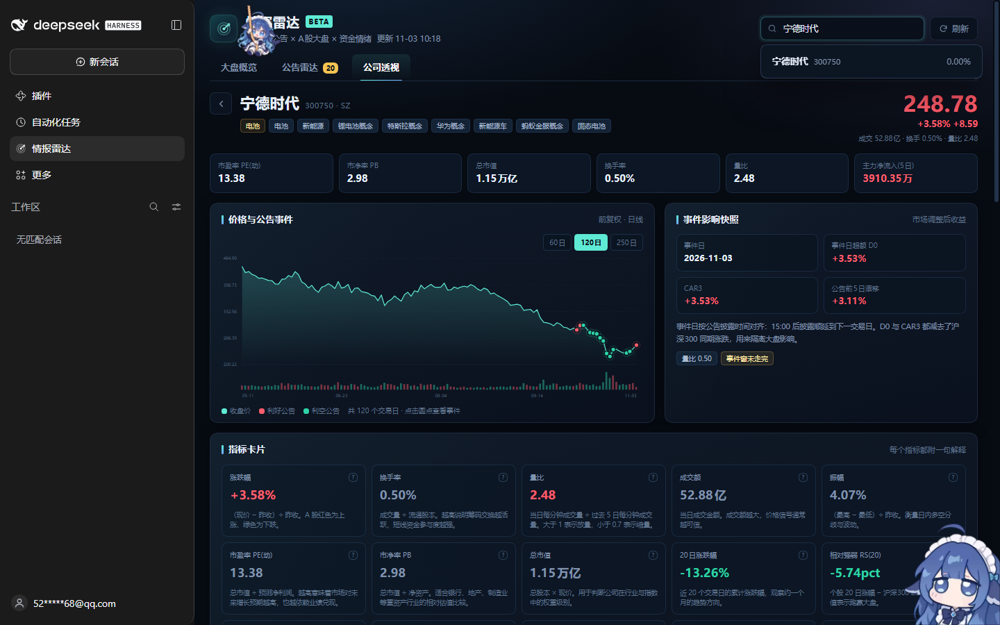

# 情报雷达 · dsh-market-radar

[](https://github.com/ufoyangyang/dsh-market-radar)
[](LICENSE)
[](https://dsh-plugin.org)

一个挂在 DSH 左侧栏的 A 股信息影响分析面板：把**巨潮资讯公告**、**dapan.app 大盘云图**、**东方财富行情/资金流/要闻**拼在一起，回答三个问题：

1. 今天哪些公告/政策最重要，它们对应公司股价实际怎么走？
2. 大盘现在是什么温度，钱在往哪些板块去？
3. 点开一家公司，关键指标是多少，每个指标到底意味着什么？

> 所有数据来自公开接口，指标为启发式计算，**不构成投资建议**。



## 功能

### 大盘概览

- 6 大指数实时卡片：上证、深证、创业板、沪深300、中证500、北证50。
- 市场情绪 0–100：涨跌家数、指数动量、量能变化、涨跌停、主力资金五项加权；给出“偏冷/中性偏强/亢奋”等温度标签。
- 涨跌与量能：全 A 涨/平/跌家数、两市成交额及较昨同期变化、近似涨停/跌停数。
- 资金走向：主力净流入、近 12 日柱状图、板块净流入/流出 Top。
- 板块热力：31 个一级行业 squarified treemap，面积≈市值，红涨绿跌；点色块直接筛该板块公告。
- 政策与要闻：按政策级别 + 关键词 + 当日市场反应排序，标注受影响板块及板块涨跌。
- 高影响公告 Top 列表：影响分、方向、当日涨跌、CAR3。

### 公告雷达

- 影响级别（高/中/低）、方向（利好/利空/中性）、板块、公司/标题全文筛选。
- 表格列：影响分环、披露时间、公司、公告标题、板块、今日涨跌、CAR3、方向。
- 默认按影响分排序，支持“加载更多”；点击行进入公司透视。
- 公告去重并按公司分散：同一事件的多份“预案/摘要/风险提示”不会霸屏。

### 公司透视

- 搜索公司代码/名称/拼音，或从公告、板块、同行表点入。
- 价格与公告事件图：60/120/250 日 K 线、成交量、利好/利空公告标记、悬停十字线。
- 事件影响快照：事件日、D0 超额、CAR3、公告前 5 日漂移、量能确认、是否“事件未走完”。
- 15 张指标卡，每张都带一句“这是什么、怎么读”的解释。
- 公告与事件时间线：D0、CAR3、前 5 日、量比、原文 PDF 链接。
- 同行对比与名词表。



## 指标解释

| 指标 | 计算 | 怎么读 |
| --- | --- | --- |
| 涨跌幅 | (现价 − 昨收) / 昨收 | A 股红涨绿跌；单日情绪的最直接刻度 |
| 换手率 | 成交量 / 流通股本 | 越高说明筹码交换越活跃，短线资金参与越深 |
| 量比 | 当日每分钟成交量 / 过去 5 日每分钟均量 | >1 放量，<0.7 缩量；用来看公告是否“有量确认” |
| 成交额 | 当日累计成交金额 | 比成交量更能跨股票比较；价涨量增通常更可信 |
| 振幅 | (最高 − 最低) / 昨收 | 日内多空分歧与波动剧烈程度 |
| 市盈率 PE(动) | 总市值 / 预测净利润 | 市场愿意为未来盈利付多少钱；行业间不可直接横比 |
| 市净率 PB | 总市值 / 净资产 | 银行、地产、制造业常用；需结合 ROE |
| 总市值 | 总股本 × 现价 | 判断公司在行业、指数中的权重级别 |
| 20 日涨跌幅 | 近 20 个交易日累计涨跌 | 约一个月的趋势方向，过滤单日噪声 |
| 相对强弱 RS(20) | 个股 20 日涨幅 − 沪深300 20 日涨幅 | 正值跑赢大盘；区分“绝对上涨”和“相对强势” |
| 年化波动率 | 近 60 日日收益率标准差 × √252 | 价格不稳定性；越高仓位与回撤压力越大 |
| 最大回撤(60日) | 近 60 日区间高点到后续低点最大跌幅 | 衡量持有体验与下行风险 |
| 均线位置 | 收盘价与 MA20 / MA60 的关系 | 多头排列=价>MA20>MA60；反之为空头排列 |
| 主力净流入(5日) | 近 5 日超大单 + 大单净买入 | 大额委托方向，不等于“国家队”或单一机构 |
| 近一年公告数 | 近 365 天巨潮公告数 | 公告密度高通常事件驱动更频繁 |

### 影响分与事件研究

- **影响分 0–100** = 公告类别基础权重（重组、监管风险、订单、业绩等）+ 市场反应幅度 + 量能确认 + 时效；高只代表信息与波动共振强，不代表方向。
- **事件日**：公告披露日（15:00 后顺延到下一交易日）。
- **D0 超额** = 个股当日涨跌幅 − 沪深300 当日涨跌幅。
- **CAR3** = 事件日及之后 3 个交易日累计超额收益，用来剔除大盘涨跌，观察“这条信息本身”的相对定价。
- **方向标签** 由标题关键词判定；若市场反应与标签相反，会标注“市场不买账/利空钝化”。

## 安装

### 从 GitHub 安装（推荐）

```bash
dsh plugin --profile web add git+https://github.com/ufoyangyang/dsh-market-radar.git
```

装完刷新页面即可；若左侧仍未出现，重启 `dsh web`。仓库已带 `dsh-plugin` topic，也会被 [DSH Plugin Hub](https://dsh-plugin.org) 自动收录。

### 本地开发挂载

```bat
mklink /J "%USERPROFILE%\.dsh\profiles\web\node_modules\dsh-market-radar" "D:\codex_workspace\investigate_info\dsh-market-radar"
```

然后在 `%USERPROFILE%\.dsh\profiles\web\cordis.patch.yml` 末尾加入：

```yaml
# 情报雷达：巨潮公告 × A股大盘 × 资金情绪
- insert:
    - id: market-radar
      name: dsh-market-radar
```

`patchReload: live` 会热加载宿主半侧；浏览器半侧由 `dsh-client-modules` 从 `/plugins` 提供，刷新页面即可看到左侧“情报雷达”入口。

## 数据源与刷新

| 来源 | 用途 | 缓存 |
| --- | --- | --- |
| 巨潮资讯 `hisAnnouncement/query` | 公告标题、时间、PDF、公司 | 90s（公司公告 5min） |
| 东方财富公告 feed | 巨潮 403 时的公告兜底 | 90s |
| dapan.app `/api/heatmap/treemap` | 31 板块、5,580 只股票、涨跌家数、成交额 | 50s |
| 东方财富 `push2` / `push2his` | 指数、个股行情、K 线、资金流 | 30–90s |
| 东方财富新闻 `column=344` | 政策与要闻 | 120s |

- 大盘页每 90 秒自动刷新；个股详情按需加载。
- 巨潮连续请求会触发 403 熔断（8 分钟），此时自动切东方财富并打 `source` 标记。
- dapan 的 treemap 约 1MB，正常 2–5 秒，网络慢时可能 10–18 秒；采用“先发 dapan，再错峰其它源”的调度。成功后缓存 50 秒，失败时优先回退最近一次成功快照（保留 20 分钟），不会把热力图直接打成空白。

## 本地 API

宿主半侧注册在 `/dsh-market-radar/api`：

| 路由 | 说明 |
| --- | --- |
| `GET /dashboard` | 指数、情绪、板块、资金、新闻、公告聚合 |
| `GET /company?code=300750` | 公司行情、K 线、指标、公告事件、同行 |
| `GET /search?q=宁德` | 代码/名称/拼音搜索 |
| `GET /health` | 插件存活检查 |

公司接口以 K 线为主干：行情、指数、公告、dapan 任一失败都只降级对应区块，不会让整页 502。

## 开发

无需构建：`lib/client.js` 是 DSH 客户端模块系统要求的 CJS 包装（`window.__ModuleLoader__.load`），`lib/index.js` 是宿主 Cordis 插件。

```bat
node --check lib\index.js
node --check lib\client.js
```

`tmp/dom-test.mjs` 是本地 jsdom 渲染冒烟测试（不随插件发布）。

## 已知限制

- 巨潮公告接口有 IP 频率限制，密集查询会短时 403；已做熔断与东财兜底。
- 涨跌停数为按涨跌幅近似的口径（ST 4.8%、30/68 开头 19.5%、4/8/92 开头 29.5%、其余 9.8%），不是交易所官方封板数。
- 资金流为东方财富“超大单 + 大单”口径，不同数据商可能不一致。
- 事件研究用沪深300 作为市场基准，未做行业中性化。
- 所有内容仅供研究，不构成投资建议。
